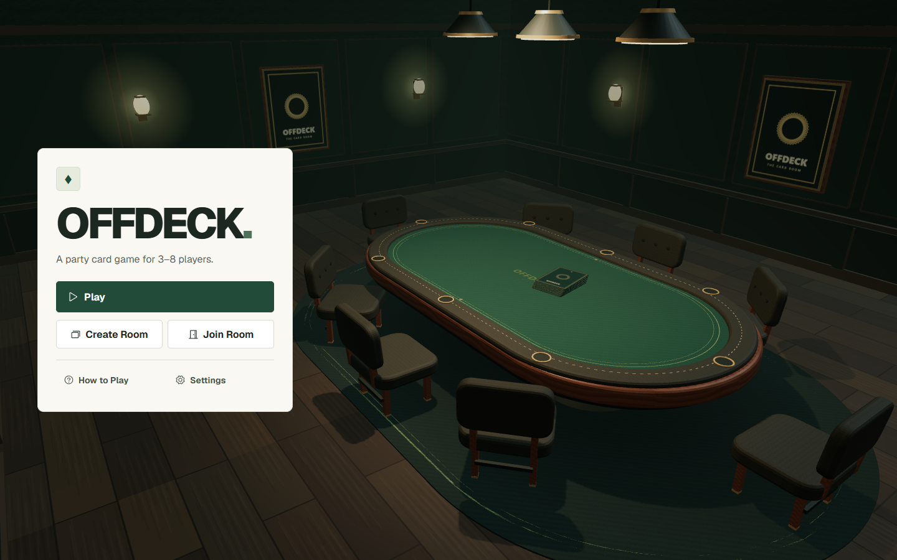

# OFFDECK

OFFDECK is a first-person 3D party card game for **3–8 adults** in a desktop browser. Invite friends to a private poker table, play an anonymous response, and vote for the funniest combination.

**18+ content warning.** OFFDECK contains explicit language, sexual humor, dark comedy, and mature themes. First-time visitors confirm they are 18 or older. The browser remembers this self-declaration locally.

**New in v0.3.2.** Learn at your own pace with the interactive practice table, open **Game Rules** from the menu, lobby, or match, and turn gameplay hints on or off in **Settings**.

The deck includes **250 approved scenarios** and **750 approved responses**, with short punchlines and prompts that include overheard lines, messages, confessions, and fill-ins.

Each standard match draws **20 unique scenarios**. The server balances scenario categories and favors cards the room hasn't seen recently. It shuffles responses, deals them privately and recycles them when the draw pile runs out. Recent card history stays with the room across rematches.

## Screenshots

Match screenshots use three connected browser clients and a three-scenario test deck. Practice screenshots use the built-in sample round.




[18+ confirmation](docs/screenshots/age-confirmation.png) · [Multiplayer lobby](docs/screenshots/lobby.png) · [Card inspection](docs/screenshots/card-inspection.png) · [Round results](docs/screenshots/round-results.png) · [Final leaderboard](docs/screenshots/final-results.png)

[Game Rules](docs/screenshots/game-rules.png) · Practice table: [inspect a scenario](docs/screenshots/tutorial-scenario.png), [pick a response](docs/screenshots/tutorial-response.png), [vote anonymously](docs/screenshots/tutorial-voting.png)

## Quick start

Use Git, Node.js **22.12 or later** with npm, and a desktop browser with WebGL 2. The release was tested with Node.js 24 and Chromium.

```sh
git clone https://github.com/itsmangooo/offdeck.git
cd offdeck
npm ci
npm run dev
```

Open [http://127.0.0.1:3000](http://127.0.0.1:3000). The command starts the Vite frontend and Socket.IO server on the same origin. Use three Chromium profiles, a mix of browsers, or Playwright contexts to try a full local match with separate seats.

For friends on your LAN, set `HOST=0.0.0.0` in a local `.env` and have everyone open the server’s LAN address. The app generates its invitations from the address in the browser unless `PUBLIC_ORIGIN` is configured.

## How to play

1. Confirm you are 18 or older and choose a nickname. Select **Start Tutorial** to try a practice round or **Skip Tutorial** to go straight to the game. If you opened an invitation, you take your seat after leaving practice. Your browser remembers whether you finished or skipped the tutorial.
2. Create a room and share its invitation link, or open an invitation. The host can start when at least three players are connected.
3. Click the scenario card for a close-up. Press **Esc** or choose **Close inspection** to return to the table. Hover over a response to read it and click to lock in one of your five cards.
4. Responses are revealed anonymously when everyone submits or the timer expires. If you submitted, cast one private vote for another player's card. **Vote cast** confirms your choice privately. Vote totals and response authors are revealed in the results.
5. Each vote received is worth one point. Ties are shared. Played responses are discarded, and a replacement brings each hand back to five for the next scenario.
6. Rounds advance automatically until the scenario deck runs out. The final leaderboard shows the overall winner or tied winners. The host can start a fresh match in the same room.

Move the mouse to look around from your seat. Open **Card list** in the upper-left HUD for keyboard submission, voting and scenario inspection. Reduced motion holds the camera steady and settles cards directly into place. Graphics quality adjusts resolution and shadows. A newcomer joining an active match spectates and can play in the next one.

Open **How to Play** or **Replay Tutorial** from the main menu, or choose **Replay Tutorial** in **Settings** while outside a room. **Game Rules** explains timings, disconnects, and rematches. The match clock keeps running while you read. Turn off **Gameplay hints** in **Settings** whenever you no longer need them. Your browser remembers your nickname for 365 days, and you can change it in **Settings**.

## Card collection

The source database is [scenarios.json](decks/scenarios.json) and [responses.json](decks/responses.json). Each record has a stable `id`, `type`, `text`, primary `category` and `status`. Use optional `tags` for secondary themes and optional `compatibility` notes for response forms. The six categories are Sex & Hookups, Dating & Relationships, Men vs. Women, Dark Humor, Social Disasters and Unhinged.

- **Draft** keeps a work in progress available for editing.
- **Approved** makes a card eligible to appear in games.
- **Disabled** removes the card from play while preserving its record and ID.

### Add or revise cards

1. Run `npm run cards:edit` and open [the local editor](http://127.0.0.1:3417). It runs as a separate loopback-only process.
2. Choose **New card** or search for an existing card by text or ID. Choose a type and primary category, then enter up to 120 characters. Use one `____` for a fill-in. Add comma-separated lowercase tags or response forms when they help review.
3. Read the line aloud, inspect the shared-renderer preview and check the similar-card warning. Save new work as **Draft**. Switch it to **Approved** after review. **Disable card** is reversible. **Delete card** permanently removes the record after confirmation.
4. Review the JSON diff and validate the collection. Restart the game server to load approved edits.

```sh
npm run cards:validate
npm run cards:review -- full-031 --all-responses
```

When editing JSON directly, reserve new IDs for new premises and keep IDs stable for revisions. The database supports additional cards without changing match size. When a future release expands the approved collection, update the release-count check in `scripts/validate-cards.js` and the corresponding assertions. See the [writing guide](docs/CARD_STYLE.md), [pairing review](docs/CARD_REVIEW.md) and [local editor screenshot](docs/screenshots/card-editor.png).

## Project structure

| Path | Contents |
| --- | --- |
| `client/` | JavaScript UI, Three.js scene, storage, card interactions and Web Audio cues |
| `server/` | Express, Socket.IO, room sessions, private state, deadlines and authoritative match rules |
| `shared/` | Protocol, card-face renderer and wording similarity checks |
| `decks/` | Source card database with status and optional editorial metadata |
| `scripts/` | Local editor, validation and pairing review commands |
| `public/` | Browser assets and third-party license notices |
| `test/` | Node rules and transport tests plus Playwright multiplayer and visual tests |
| `docs/` | [v0.3.1 verification record](docs/V0.3.1.md), editorial guides and screenshots |

The app uses JavaScript, Vite, Three.js and Web Audio on the client, with Node.js, Express and Socket.IO on the server. The server maintains hands, deadlines, submissions, votes and scores. Each client receives a private, viewer-specific snapshot.

## Testing

```sh
npm test
npx playwright install chromium
npm run test:browser
```

The Node suite verifies content, editor writes and a full 20-scenario match over eight WebSocket connections. Playwright checks the rules, tutorial, saved onboarding choice, invitation handling and gameplay hints alongside full matches, rematches, reconnects and host migration. The rules and practice controls are checked at three desktop sizes and a narrow 390-pixel viewport. See the [v0.3.1 verification record](docs/V0.3.1.md) for the deck overhaul.

To run the browser suite against the production bundle, run `npm run build` and then use the command for your shell.

```sh
OFFDECK_BROWSER_PROD=1 npm run test:browser
```

```powershell
$env:OFFDECK_BROWSER_PROD = '1'
npm run test:browser
```

On Windows with installed Chrome, set `OFFDECK_CHROME_D3D11=1` to run the browser suite with hardware acceleration. After building, run `node test/measure-scene.js --chrome` for the reproducible 1440×900 sample.

## Deployment

### Silicon

Create or select a **Git + Dockerfile** application on a connected Docker target. In Silicon’s GitHub App integration, bind `itsmangooo/offdeck` to the `main` branch and enable **Deploy verified pushes**. Silicon builds the root `Dockerfile` at the exact commit from the webhook.

Set the internal container port to `3000` and the application’s `PUBLIC_ORIGIN` to the game's public HTTPS URL. Point the public route at that service and forward WebSocket upgrades. The image includes a Docker health check for `/healthz`.

GitHub Actions runs content validation, tests, the production build, and a Docker smoke test for pull requests and pushes to `main`. Silicon handles live deployments through its GitHub App. Verify the exact commit and the final health status on Silicon’s Deployments page.

### Docker Compose

Set `PUBLIC_ORIGIN` in `.env` to the game's public HTTPS URL and run:

```sh
docker compose build --pull
docker compose up -d --wait
```

Compose publishes `127.0.0.1:3000` for an HTTPS reverse proxy on the same host. Set `PORT` in `.env` to change the host port, and match it in the proxy configuration. Rebuild the image when card files change.

### Direct Node.js deployment

```sh
npm ci
npm run build
npm start
```

Use [`.env.example`](.env.example) as the configuration reference. Run one Node process behind an HTTPS reverse proxy. Set `PUBLIC_ORIGIN` to the public HTTPS origin, such as `https://offdeckgames.com`. An invitation has the format `https://offdeckgames.com/sid/{sessionId}/`. Node serves the frontend package and handles direct navigation to those URLs.

Proxy HTTP requests and WebSocket upgrades to the same process. Preserve the original host and forward `Upgrade` and `Connection` for `/socket.io/`. The following Nginx example goes in the TLS virtual host, with the `map` in the surrounding `http` context. [Nginx WebSocket proxying documentation](https://nginx.org/en/docs/http/websocket.html)

```nginx
# http context
map $http_upgrade $connection_upgrade {
    default upgrade;
    ''      close;
}

# HTTPS server context
location / {
    proxy_pass http://127.0.0.1:3000;
    proxy_http_version 1.1;
    proxy_set_header Host $host;
    proxy_set_header X-Forwarded-Proto $scheme;
    proxy_set_header Upgrade $http_upgrade;
    proxy_set_header Connection $connection_upgrade;
    proxy_read_timeout 75s;
}
```

`GET /healthz` is available for a local or proxy health check. Restart the process to load edited deck files. In-memory rooms are scoped to a single process and expire after 30 minutes of inactivity. A restart ends outstanding rooms. Disconnected seats are reserved for two minutes. An active match pauses while fewer than three participating players are connected, and ends as abandoned if too few reserved seats remain to resume.

## License and credits

The project source, starter decks and procedural room, avatars, artwork and sounds are available under the [MIT license](LICENSE).

- [Three.js](https://threejs.org/) under [MIT](public/licenses/three-MIT.txt).
- [Phosphor Icons](https://phosphoricons.com/) under [MIT](public/licenses/phosphor-MIT.txt).
- [Geist](https://vercel.com/font) under the [SIL Open Font License 1.1](public/licenses/geist-OFL.txt).
- [Socket.IO](https://socket.io/) and its client dependencies under the [included notices](public/licenses/).
