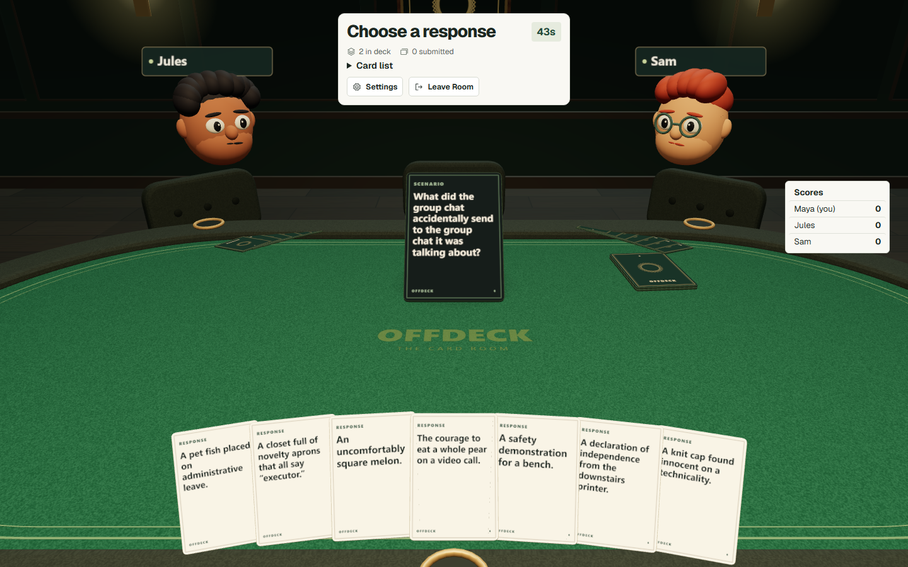

# OFFDECK

OFFDECK is a first-person 3D party card game for **3–8 players** in a desktop browser. Invite friends to a private poker table, match a response card to the scenario, and vote for the funniest combination.

- Create a private room and share its invitation link. Each player joins with a nickname.
- Sit at an eight-seat 3D poker table with floating-head avatars and a physical seven-card hand.
- Submit and vote by clicking cards. Responses are shuffled and anonymous until voting ends.
- Earn one point for each vote received. Scenarios progress automatically until the deck is exhausted.
- Refresh or reconnect to the same seat. The room migrates the host when needed.
- Play with 100 original scenarios and 400 original responses. Adjust volume, camera sensitivity, graphics quality and motion locally.

## Screenshots

Captured from the production build with three connected browser clients using a three-scenario test deck.





[Multiplayer lobby](docs/screenshots/lobby.png) · [Round results](docs/screenshots/round-results.png) · [Final leaderboard](docs/screenshots/final-results.png)

## Quick start

Use Git, Node.js **22.12 or later** with npm, and a desktop browser with WebGL 2. The release was tested with Node.js 24 and Chromium.

```sh
git clone https://github.com/itsmangooo/offdeck.git
cd offdeck
npm ci
npm run dev
```

Open [http://127.0.0.1:3000](http://127.0.0.1:3000). The command starts the Vite frontend and Socket.IO server on the same origin. Use three Chromium profiles, a mix of browsers, or Playwright contexts to try a full local match with separate seats.

For friends on your LAN, set `HOST=0.0.0.0` in a local `.env` and have everyone open the server’s LAN address. The app generates its invitations from the address in the browser unless `PUBLIC_ORIGIN` is configured.

## How to play

1. Choose a nickname. The browser remembers it for 365 days. Change it in **Settings**.
2. Create a room or open an invitation. The host can start when at least three players are connected.
3. Read the scenario at the center of the table. Hover over any card in your seven-card hand to inspect it, then click the card to lock it in. The default response timer is 45 seconds.
4. After the reveal, click another player’s response to vote. Each player who submitted a response can cast one vote. The default voting timer is 30 seconds.
5. Read the authors and vote totals in the results. Each vote received is worth one point. The highest-voted response wins the round, with ties shared.
6. Play continues automatically. After the last scenario, the final leaderboard highlights the highest-scoring player or tied players. The host can play again in the same room.

Move the mouse to look around the table. Open **Card list** in the match overlay for readable text and keyboard controls. The browser enables sound after the first interaction. A newcomer joining an active match spectates and can play in the next one.

## Project structure

| Path | Contents |
| --- | --- |
| `client/` | JavaScript UI, Three.js scene, storage, card interactions and Web Audio cues |
| `server/` | Express, Socket.IO, room sessions, private state, deadlines and authoritative match rules |
| `shared/` | Protocol constants and nickname validation |
| `decks/` | Editable JSON arrays of English scenario and response text |
| `public/` | Browser assets and third-party license notices |
| `test/` | Node rules and transport tests plus Playwright multiplayer and visual tests |
| `docs/` | [Development milestones](docs/MILESTONES.md) and screenshots |

The app uses JavaScript, Vite, Three.js and Web Audio on the client, with Node.js, Express and Socket.IO on the server. The server maintains hands, deadlines, submissions, votes and scores. Each client receives a private, viewer-specific snapshot. Card text is loaded from the two JSON decks at server startup. Use unique, non-empty strings of up to 170 characters when editing either deck.

## Testing

```sh
npm test
npx playwright install chromium
npm run test:browser
```

The Node suite exercises the full 100-scenario deck at eight seats. The browser suite completes a three-scenario match through physical cards in three independent contexts and checks the lobby, scoring, rematches, reconnects, settings, audio and the eight-response layout.

To run the browser suite against the production bundle, run `npm run build` and then use the command for your shell.

```sh
OFFDECK_BROWSER_PROD=1 npm run test:browser
```

```powershell
$env:OFFDECK_BROWSER_PROD = '1'
npm run test:browser
```

## Deployment

```sh
npm ci
npm run build
npm start
```

Use [`.env.example`](.env.example) as the configuration reference. Run one Node process behind an HTTPS reverse proxy. Set `PUBLIC_ORIGIN` to the public HTTPS origin, such as `https://offdeckgames.com`. An invitation has the format `https://offdeckgames.com/sid/{sessionId}/`. Node serves the frontend package and handles direct navigation to those URLs.

Proxy HTTP requests and WebSocket upgrades to the same process. Preserve the original host and forward `Upgrade` and `Connection` for `/socket.io/`. The following Nginx example goes in the TLS virtual host, with the `map` in the surrounding `http` context. [Nginx WebSocket proxying documentation](https://nginx.org/en/docs/http/websocket.html)

```nginx
# http context
map $http_upgrade $connection_upgrade {
    default upgrade;
    ''      close;
}

# HTTPS server context
location / {
    proxy_pass http://127.0.0.1:3000;
    proxy_http_version 1.1;
    proxy_set_header Host $host;
    proxy_set_header X-Forwarded-Proto $scheme;
    proxy_set_header Upgrade $http_upgrade;
    proxy_set_header Connection $connection_upgrade;
    proxy_read_timeout 75s;
}
```

`GET /healthz` is available for a local or proxy health check. Restart the process to load edited deck files. In-memory rooms are scoped to a single process and expire after 30 minutes of inactivity. A restart ends outstanding rooms. Disconnected seats are reserved for two minutes. An active match pauses while fewer than three participating players are connected, and ends as abandoned if too few reserved seats remain to resume.

## License and credits

The project source, starter decks and procedural room, avatars, artwork and sounds are available under the [MIT license](LICENSE).

- [Three.js](https://threejs.org/) under [MIT](public/licenses/three-MIT.txt).
- [Phosphor Icons](https://phosphoricons.com/) under [MIT](public/licenses/phosphor-MIT.txt).
- [Geist](https://vercel.com/font) under the [SIL Open Font License 1.1](public/licenses/geist-OFL.txt).
- [Socket.IO](https://socket.io/) and its client dependencies under the [included notices](public/licenses/).
